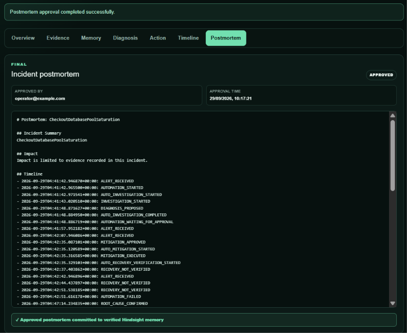
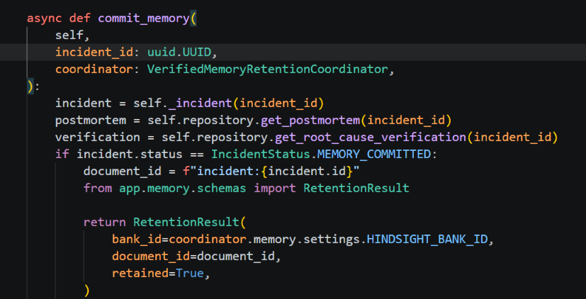
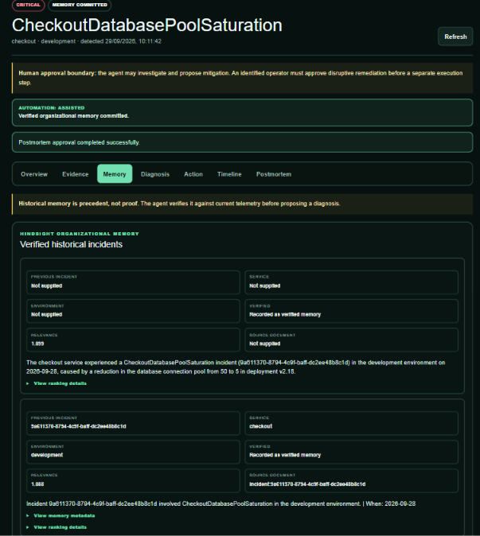

# Why I Made My Incident Agent Remember Previous Outages

An incident investigator that forgets every resolved outage is condemned to repeat the same diagnostic work. I wanted this system to reuse hard-won operational knowledge, but only after that knowledge had survived human review.

## The cost of a stateless investigator

The Incident Response Agent begins with a conventional event path: Prometheus evaluates alert rules, Alertmanager posts a typed webhook to FastAPI, and PostgreSQL records the incident and its events. That is enough to investigate one outage. It is not enough to improve the next investigation.

Consider the recurring checkout database-pool scenario. In the controlled fault-injection environment, a deployment changes the checkout service from version 2.17 to 2.18 and reduces the connection-pool setting from 50 to 5. Current metrics can show that available connections reached zero. Loki can return connection-acquisition timeouts, Tempo can show affected traces, and the deployment endpoint can identify the configuration change. After rollback and recovery, the team knows considerably more than the alert initially contained.

Without long-lived memory, the next occurrence starts from zero. The investigator can rediscover the cause, but it cannot reuse the previous incident's confirmed root cause, decisive evidence, mitigation, failed paths, runbook context, or recovery checks. That is wasted work and, more importantly, lost organizational context.

I used [Hindsight's open-source memory service](https://github.com/vectorize-io/hindsight) for this durable recall layer. The useful mental model is the one described in [Vectorize's explanation of agent memory](https://vectorize.io/what-is-agent-memory): memory is an external capability with its own lifecycle, not an ever-growing prompt.

## Memory starts after verification, not after prediction

The most important design decision was deciding what the system is allowed to remember. A model-generated hypothesis is not organizational knowledge. Neither is an automatically generated postmortem draft.

The application schema makes the retention boundary explicit:

```python
class VerifiedIncidentMemory(BaseModel):
    confirmed_root_cause: str
    decisive_evidence: list[str] = Field(min_length=1)
    successful_mitigation: str
    resolved: bool
    verified: bool

    @model_validator(mode="after")
    def trusted_memory_requirements(self) -> "VerifiedIncidentMemory":
        if not self.resolved or not self.verified or not self.confirmed_root_cause.strip():
            raise ValueError("trusted memory requires a resolved, verified incident and root cause")
        return self
```

This is from `apps/api/app/memory/schemas.py`. It prevents an unresolved or unverified incident from being converted into the trusted memory payload. The wider workflow is stricter still: the incident must be resolved, a human must confirm root cause, and a postmortem must be approved before `/memory/commit` is accepted.

That sequence matters because it blocks a subtle feedback loop. If an early AI hypothesis were retained immediately, a future recall could make the same guess look more credible simply because it had been repeated. Verification breaks that loop.



*Figure 1 — The incident is eligible for durable memory only after root-cause and postmortem verification.*


## Retaining a compact incident record in Hindsight

The retention layer does not push the entire relational incident model into a second database. `render_verified_incident()` creates a compact document containing the incident identifier, service, environment, symptoms, confirmed cause, decisive evidence, successful mitigation, failed paths, runbook, recovery verification, caveats, and verification basis.

The service then writes that document with an incident-specific ID and strict metadata:

```python
await self.client.aretain(
    bank_id=self.settings.HINDSIGHT_BANK_ID,
    content=render_verified_incident(memory),
    document_id=f"incident:{memory.incident_id}",
    metadata={
        "incident_id": memory.incident_id,
        "service": memory.service,
        "environment": memory.environment,
        "verified": "true",
    },
    tags=[
        "verified:true",
        f"service:{memory.service}",
        f"environment:{memory.environment}",
        document_id,
    ],
    update_mode="replace",
    retain_async=False,
)
```

This excerpt from `apps/api/app/memory/service.py` shows three useful properties. The document ID is stable. Replacement mode makes a repeated commit manageable. Tags make verification, service, and environment part of retrieval rather than relying on prompt instructions alone.

PostgreSQL remains the source of truth. `VerifiedMemoryRetentionCoordinator` records `PENDING`, `SUCCEEDED`, or `FAILED` in the `memory_sync` table and stores a checksum after successful retention. If a matching synchronization row already succeeded, the coordinator returns the existing result rather than writing again.

The Hindsight SDK is isolated behind `HindsightMemoryService`, uses a configurable bounded timeout, and is closed asynchronously. If Hindsight is not configured, incident intake and database workflows still run. That separation is deliberate: memory should improve an investigation, not become a single point of failure.



*Figure 2 — The backend enforces the verification boundary before retaining an incident as organizational memory.*


## Recall is scoped before it reaches the investigator

During investigation, the agent does not issue an unconstrained memory search. The service asks Hindsight for records matching all three tags:

```python
response = await self.client.arecall(
    bank_id=self.settings.HINDSIGHT_BANK_ID,
    query=query,
    max_tokens=max_tokens,
    budget="mid",
    tags=["verified:true", f"service:{service}", f"environment:{environment}"],
    tags_match="all_strict",
)
```

The returned SDK objects are normalized into application-owned `MemoryRecord` values. Scores are preserved when Hindsight supplies them; the application does not invent a confidence number. The tool adapter labels the result `HISTORICAL_MEMORY` and adds `classification: HISTORICAL_EVIDENCE` before the investigator persists it.

The [Hindsight documentation](https://hindsight.vectorize.io/) is useful here because retain and recall have different operational shapes. The repository keeps those SDK details inside one service rather than spreading them across routes and agent code.

## A repeated database-pool incident

The concrete payoff appears when the same Alertmanager fingerprint fires in a later occurrence. The database permits historical incidents to share a fingerprint while enforcing one active incident per fingerprint. The new occurrence therefore receives a new incident UUID instead of reopening the resolved row.

For the recurring checkout failure, `recall_incidents` is the first evidence step. Hindsight can return the previous verified pool-exhaustion incident, including its confirmed cause and successful rollback. The investigator then still collects current pool state, payment latency, connection-timeout logs, traces, deployment evidence, and the checked-in runbook.



*Figure 3 — A later incident can retrieve the previous verified checkout incident, while the investigator still validates it against current telemetry.*


Before memory, the investigator has only current telemetry and operational documents. After memory, it also has a concise record of what previously happened and which evidence was decisive. It can prioritize useful checks without treating the old answer as automatically correct.

That is the distinction I wanted: faster orientation, not inherited certainty.

## What this design does not solve

Verified memory can still become stale. A once-correct mitigation may be wrong after an architecture change. Service and environment tags reduce irrelevant recall, but they do not prove present causality. The application therefore treats recalled material as untrusted evidence and requires current telemetry before diagnosis.

The current design also uses one configured Hindsight bank and synchronous server-side retention with a bounded timeout. It does not yet model retention queues, multi-tenant bank policies, or long-running background reconciliation. Those are operational extensions, not reasons to weaken the verification boundary.

## Practical takeaways

- Store incident learning only after resolution and explicit human verification.
- Keep the transactional incident ledger in PostgreSQL and long-lived semantic memory in a separate system.
- Use stable document IDs, strict tags, checksums, and an idempotent synchronization record.
- Normalize memory-provider responses before giving them to an agent.
- Recall early, then require current evidence before accepting historical precedent.

An incident agent becomes more useful when it remembers, but only if forgetting is safer than remembering the wrong thing. In this system, Hindsight preserves reviewed operational knowledge while the application controls when that knowledge becomes trustworthy.
