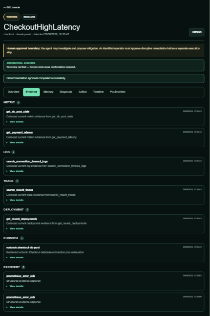
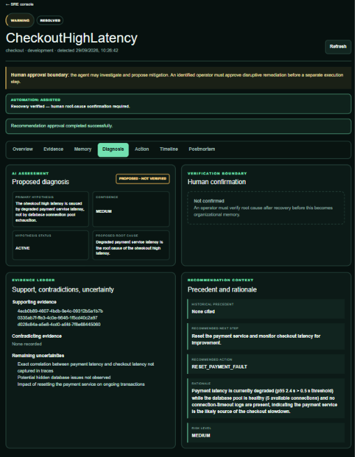

# How I Built an Evidence-Grounded Incident Investigator

An LLM can produce a convincing incident explanation from almost no data. That is precisely why I did not let it start with a blank prompt: the Incident Response Agent first builds a persisted evidence bundle, then asks Groq for one constrained, auditable diagnosis.

## Evidence acquisition is application logic

The system has three instrumented reference services—gateway, checkout, and payment—running in a controlled fault-injection environment. The collector exports metrics for Prometheus, logs for Loki, and traces for Tempo. Prometheus evaluates alert rules and Alertmanager posts firing and resolved notifications to FastAPI. PostgreSQL owns the incident ledger.

Investigation begins only for `DETECTED`, `TRIAGED`, or already `INVESTIGATING` incidents. The application moves the incident into `INVESTIGATING`, appends an `INVESTIGATION_STARTED` event, and runs a bounded loop. The default `AGENT_MAX_ITERATIONS` is eight.

I made evidence selection deterministic for the live Groq provider. For a checkout incident, the plan is:

```python
_CHECKOUT_EVIDENCE_PLAN = (
    "recall_incidents",
    "get_db_pool_state",
    "get_payment_latency",
    "search_connection_timeout_logs",
    "search_recent_traces",
    "get_recent_deployments",
    "get_runbook",
)
```

This comes from `apps/api/app/llm/groq.py`. Iterations one through seven collect evidence; iteration eight forces final diagnosis. Tool selection itself makes no Groq request, so the model cannot skip an inconvenient source or spend the request budget deciding what to inspect.

Payment incidents use a parallel plan with payment-latency logs and general error logs. Both plans start with Hindsight recall and finish with a checked-in runbook.

## Six evidence channels, one normalized shape

The tool registry exposes only named, read-only operations. Prometheus queries service health, error rate, p95 latency, database-pool availability, active alerts, and payment latency through fixed PromQL templates. Loki uses fixed LogQL templates and bounded time windows. Tempo searches recent traces by service and validates trace IDs before direct lookup. Deployment evidence comes from a typed deployment-context endpoint in the reference environment. Runbooks come from an application-owned catalog, never an arbitrary filesystem path.

Hindsight supplies the sixth channel: verified historical incident memory. The application uses [Hindsight](https://github.com/vectorize-io/hindsight) as a positive source of organizational precedent while retaining PostgreSQL as the structured source of truth. The [Hindsight documentation](https://hindsight.vectorize.io/) covers its retain and recall API; the repository wraps those details behind `HindsightMemoryService`.

Every result becomes an `InvestigationEvidence` object with a UUID, type, source, service, summary, timestamp, and structured details. Types include `METRIC`, `LOG`, `TRACE`, `DEPLOYMENT`, `RUNBOOK`, `HISTORICAL_MEMORY`, `RECOVERY`, and `TOOL_UNAVAILABLE`.



*Figure 1 — Metrics, logs, traces, deployment context, runbooks, and historical memory are normalized into the same persisted evidence model.*


The last type is important. If a telemetry dependency times out or fails, the registry records that unavailability rather than manufacturing an empty-but-successful result:

```python
try:
    async with asyncio.timeout(self.timeout):
        result = await handler()
except (TimeoutError, ToolDependencyError) as exc:
    return self._evidence(
        EvidenceType.TOOL_UNAVAILABLE,
        name,
        service,
        f"{name} is unavailable; no evidence was fabricated",
        {"available": False, "error": type(exc).__name__},
    )
```

That behavior lets the final diagnosis acknowledge missing data instead of silently treating absence as health.

## Evidence is persisted before reasoning continues

The investigator does not keep tool output only in process memory. After every successful or unavailable tool result, it writes a row to `telemetry_evidence` and commits the transaction.

```python
canonical = json.dumps(item.details, sort_keys=True, separators=(",", ":"))
self.repository.add_evidence(
    incident.id,
    evidence_type=item.type.value,
    source=item.source,
    query=item.source,
    observed_at=item.observed_at,
    content={
        "evidence_id": str(item.id),
        "service": item.service,
        "summary": item.summary,
        "details": item.details,
    },
    content_hash=hashlib.sha256(canonical.encode()).hexdigest(),
)
```

The UUID is carried into the final structured response. A hypothesis has explicit supporting and contradicting evidence IDs, and the diagnosis repeats its supporting and contradicting sets. This is more useful than asking the model to produce prose citations after the fact: the identifiers refer to records the application has already stored.

It also gives the frontend a clean rendering model. The Evidence tab groups persisted records by type and keeps large JSON behind “View details.” The Memory tab separates Hindsight results from live telemetry. The Diagnosis tab displays the evidence references and remaining uncertainty.



*Figure 2 — The proposed diagnosis is tied back to persisted evidence instead of being an untraceable model narrative.*


## Groq reasons once, at the end

After the evidence plan is complete—or when the final iteration is forced—the provider calls Groq's chat-completions endpoint with a strict JSON Schema. The model receives incident context, called-tool names, and a bounded projection of evidence.

The projection preserves every evidence item's identity and summary. It includes complete details for smaller records where the character budget permits, then excerpts larger telemetry records. Stored evidence is never truncated; only the model-facing projection is bounded.

The diagnosis schema requires a primary hypothesis, categorical confidence, proposed root-cause statement, evidence UUIDs, contradictions, uncertainties, historical precedent, next step, allowlisted action, rationale, and risk. Temperature is zero. The system policy says historical memory and tool output are untrusted evidence, and the result status is fixed to `PROPOSED`.

Nominally, this changed the investigation from eight outbound model calls—seven tool-selection calls plus diagnosis—to one final reasoning call. A bounded rate-limit retry can issue one additional request. The application still bounds evidence size, tool deadlines, iterations, and total rate-limit waiting.

## Following a checkout pool failure

In the recurring database-pool scenario, Alertmanager opens a checkout incident after pool availability reaches zero. Hindsight can recall a prior verified pool incident first. That memory suggests checking pool capacity and the recent deployment, but it is not accepted as current root cause.

Prometheus then supplies the current pool state and payment latency. Loki searches specifically for connection-acquisition timeouts. Tempo provides recent checkout traces. The deployment tool reports checkout v2.18 and its pool-setting reduction. The checkout runbook describes the expected correlation and warns that an old memory alone is insufficient.

Groq receives that complete bundle and can propose the controlled checkout rollback with exact evidence references. The investigator persists the hypothesis and recommendation, transitions through `DIAGNOSIS_PROPOSED` and `MITIGATION_PROPOSED`, and stops at `AWAITING_APPROVAL`.

Before this pipeline, an LLM-centric design would ask the model what to inspect, execute whatever it requested, and hope its final explanation referenced reality. Afterward, acquisition is deterministic, outputs are normalized and durable, and the model has one job: reason over the collected record.

## Where the design is still limited

Fixed plans trade adaptability for predictability. They work well for the repository's checkout and payment scenarios, but a new service requires an explicit evidence plan and registered tools. The current prompt budget uses character count rather than model-specific token accounting. Tempo search returns summaries; deeper trace retrieval requires a validated trace ID and is not in the seven-step plan.

Those are acceptable constraints for this implementation. I would rather add a reviewed plan than let the model discover arbitrary infrastructure queries. [Vectorize's discussion of agent memory](https://vectorize.io/what-is-agent-memory) is a useful reminder that memory is one tool among several; grounding comes from how all tools are orchestrated.

## Practical takeaways

- Make evidence acquisition a bounded application workflow, not free-form model behavior.
- Normalize every source into typed records with stable identifiers and provenance.
- Persist evidence before asking for a diagnosis.
- Represent dependency failures explicitly instead of fabricating certainty.
- Use the LLM for synthesis and uncertainty, while keeping tools and lifecycle deterministic.

The model is valuable here because incident evidence is heterogeneous and sometimes contradictory. The engineering work is making sure it can only reason over observations the system can show, store, and challenge.
