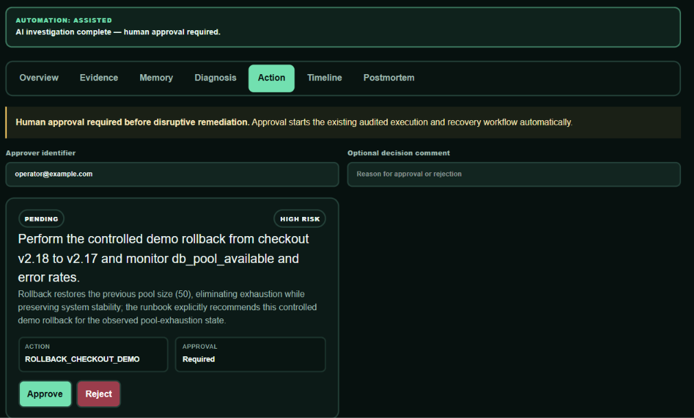
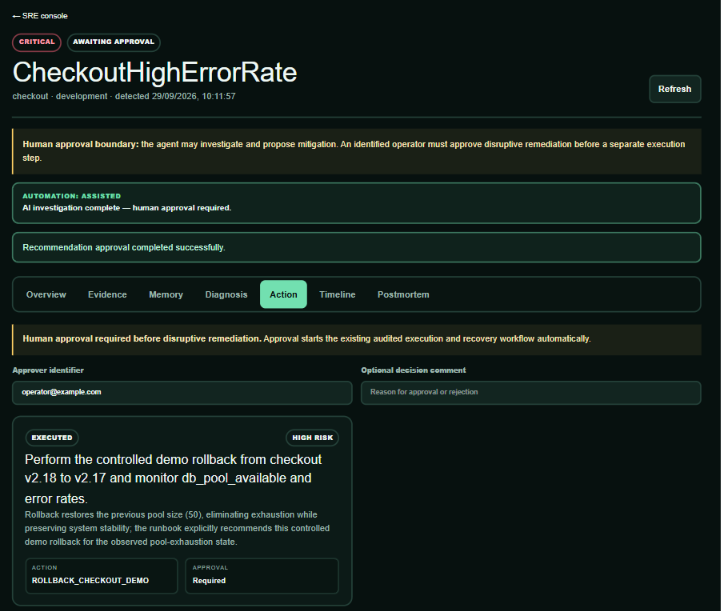
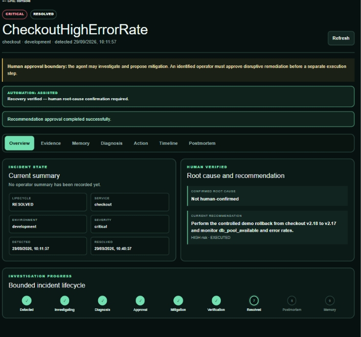

# Why My Incident Agent Can Recommend a Fix but Cannot Execute One Alone

The Incident Response Agent can investigate an outage and recommend a mitigation. It cannot approve that recommendation, cannot invent an execution mechanism, and cannot declare recovery because an API call returned 200. Those restrictions are features, not missing automation.

## Diagnosis and authority are different capabilities

Incident response mixes two kinds of work. Evidence synthesis benefits from probabilistic reasoning: metrics, logs, traces, deployments, runbooks, and historical incidents may support competing explanations. Production mutation requires a much narrower contract: who authorized what action, against which incident, in which state, and what proved recovery afterward?

I kept those capabilities in different components. The investigator collects evidence and returns a typed, `PROPOSED` diagnosis with an action, rationale, and risk. `IncidentWorkflowService` owns approval, execution, verification, root-cause confirmation, postmortem review, and memory commit. A controlled action gateway owns the only remediation mutations.

The boundary is visible in the action sets:

```python
ALLOWED_ACTIONS = frozenset({
    "ROLLBACK_CHECKOUT_DEMO",
    "RESET_PAYMENT_FAULT",
    "RESET_DB_POOL_FAULT",
    "NO_ACTION",
    "ESCALATE",
})

EXECUTABLE_DEMO_ACTIONS = {
    "ROLLBACK_CHECKOUT_DEMO": "/demo/actions/rollback-checkout",
    "RESET_PAYMENT_FAULT": "/demo/actions/reset-payment-fault",
    "RESET_DB_POOL_FAULT": "/demo/actions/reset-db-pool-fault",
}
```

The first list constrains model output. The second is smaller and maps named operations to fixed HTTP routes. `NO_ACTION` and `ESCALATE` can be valid recommendations without being executable mutations.

There is no shell tool, SQL tool, Docker tool, Kubernetes tool, arbitrary URL, or arbitrary PromQL/LogQL input exposed to the model. Runbooks come from a catalog, and trace IDs are validated as hexadecimal values.

## Approval is persisted, final, and separate from execution

When diagnosis finishes, the investigator persists a recommendation with `approval_required=True` and `status="PENDING"`, then moves the incident to `AWAITING_APPROVAL`. It does not call the action gateway.

An operator submits an approver identifier and an approve or reject decision through a separate endpoint. A matching existing decision is idempotent; an attempt to reverse a final decision returns a conflict. Rejection returns the incident to investigation.



*Figure 1 — The agent can recommend an action, but the operator must explicitly approve or reject it before execution is possible.*


Execution performs the checks again:

```python
approval = self.repository.get_approval(recommendation_id)
if approval is None or approval.decision != "APPROVED":
    raise ApplicationError("ACTION_NOT_APPROVED", "Human approval is required", 409)
if recommendation.action_type not in ALLOWED_ACTIONS:
    raise ApplicationError("ACTION_NOT_ALLOWED", "Action is not allowlisted", 422)
if recommendation.action_type not in EXECUTABLE_DEMO_ACTIONS:
    raise ApplicationError("ACTION_NOT_EXECUTABLE", "Recommendation is not a demo mutation", 409)
```

This is from `apps/api/app/services/workflow.py`. The UI cannot bypass it, and a fabricated HTTP request cannot turn an unapproved recommendation into action.

The API also separates approval and execution routes. That friction is intentional. It gives the operator a moment to inspect evidence, historical context, proposed root cause, contradictions, risk, and runbook guidance before mutation.



*Figure 2 — Approval records authorization; it does not automatically execute the remediation.*


## Idempotency handles retries without repeating the action

Operator consoles retry. Networks time out. A user may double-click. If the action endpoint treated each request as new intent, a nominally safe workflow could repeat a disruptive operation.

The workflow first checks for an existing `ActionExecution` associated with the recommendation and returns it when present. The database model also makes `recommendation_id` unique in `action_executions`. The test `test_approved_action_is_executed_once` invokes execution twice and asserts that the gateway is called once and the same execution object is returned.

The action gateway accepts only the predefined routes above. For a checkout rollback, the controlled reference gateway changes version 2.18 to 2.17 and resets the bounded fault mode. It does not execute commands on the host or expose arbitrary deployment-platform access.

Before these boundaries, “agent remediation” could mean a model response flowing directly into an infrastructure mutation. Afterward, it means a proposal enters a persisted approval protocol, a human decision is recorded, a fixed adapter performs one named operation, and retries return the recorded result.

## Recovery is measured, not inferred from execution

A successful rollback request moves the incident to `VERIFYING_RECOVERY`, not `RESOLVED`. The workflow waits for a bounded, configurable interval and queries current Prometheus data concurrently: error rate, p95 latency, service health, active alerts, and—when applicable—database-pool availability.

Recovery requires every relevant condition:

```python
recovered = (
    error_ok
    and latency_ok
    and health_ok
    and pool_ok
    and alerts_clear
)
```

The complete metric payload and boolean checks are persisted as `RECOVERY` evidence with a content hash. If all checks pass, the incident moves to `RESOLVED` and receives a `RECOVERY_VERIFIED` event. If not, it remains in verification and records `RECOVERY_NOT_VERIFIED` with an instruction to escalate or return to investigation.



*Figure 3 — Fresh telemetry, not the action response itself, determines whether the incident is actually resolved.*


This avoids a common automation mistake: equating “the remediation endpoint succeeded” with “the service recovered.” The action response proves only that the controlled mutation ran.

## The lifecycle is a second safety control

`apps/api/app/services/transitions.py` contains an explicit transition map. An incident cannot jump from detection to mitigation, from approval to resolution, or from resolution directly to memory. Invalid moves return a conflict instead of being accepted from the model or caller.

The normal path is detected, investigating, diagnosis proposed, mitigation proposed, awaiting approval, mitigating, verifying recovery, resolved, postmortem review, and memory committed. Failure paths can return an incident to investigation. `MEMORY_COMMITTED` is terminal.

That final stage connects remediation safety to Hindsight. The system will not preserve an AI proposal as organizational memory. It first requires measured recovery, then a human-confirmed root cause and approved postmortem. Only then does it retain a verified record through [Hindsight](https://github.com/vectorize-io/hindsight).

The [Hindsight documentation](https://hindsight.vectorize.io/) describes the memory API, while [Vectorize's agent-memory guide](https://vectorize.io/what-is-agent-memory) provides useful context for separating working context from durable memory. In this project, the human gate protects both production mutation and the knowledge that future investigations will retrieve.

## What remains deliberately incomplete

The gateway controls only bounded fault-injection and remediation paths in the reference environment; it is not a general-purpose deployment controller. The repository does not implement authentication, RBAC, multi-party approval, change windows, or organization-specific policy engines. The approver identifier is persisted but not backed by an identity provider.

Those limitations matter. The current design demonstrates enforceable separation of concerns, not a claim that a string identifier is sufficient authorization for a real fleet. A production integration should strengthen identity and policy without collapsing recommendation, approval, execution, and verification into one call.

## Practical takeaways

- Treat model output as a proposal, never as authorization.
- Maintain separate allowlists for recommendable and executable actions.
- Persist approvals and make execution idempotent at both service and database layers.
- Verify recovery from fresh telemetry instead of trusting the remediation response.
- Use an explicit lifecycle to reject out-of-order operations.

Bounded autonomy is not about distrusting every model result. It is about assigning authority to the component that can justify it. The investigator explains; the operator decides; the gateway executes; telemetry determines whether the incident is actually over.
