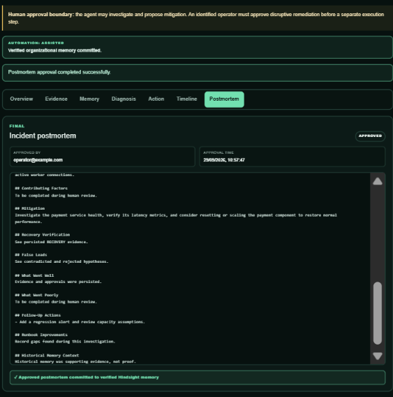
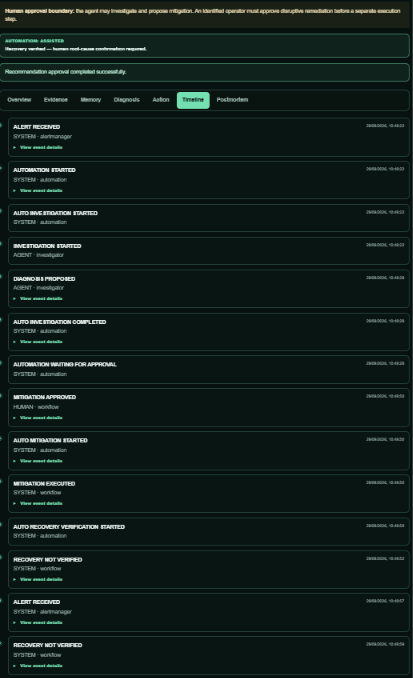
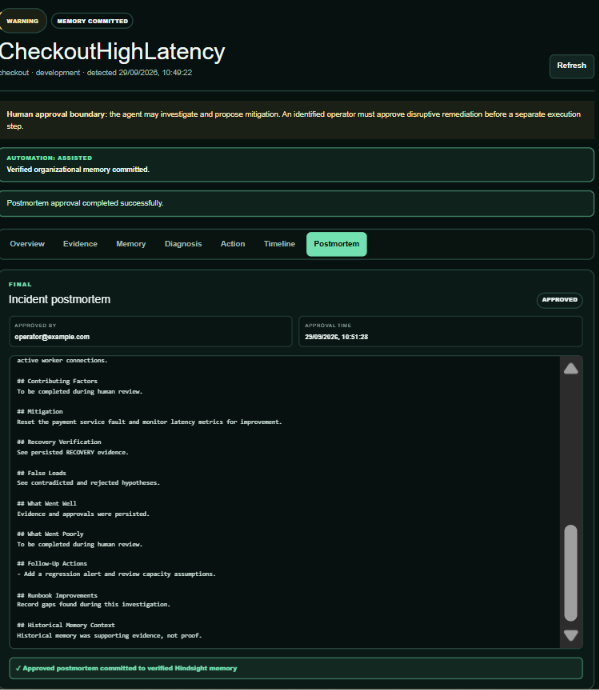

# An Incident Isn't Finished Until the System Learns From It

Restoring service is necessary, but it is not the end of incident work. If the evidence, confirmed cause, mitigation, and recovery checks disappear into a timeline nobody can retrieve, the organization pays the same diagnostic cost during the next recurrence.

## Resolution is a checkpoint, not the terminal state

The Incident Response Agent models the work after mitigation as explicitly as the investigation itself. Its status enum continues beyond `RESOLVED` to `POSTMORTEM_REVIEW` and `MEMORY_COMMITTED`. The transition map permits only:

```python
IncidentStatus.VERIFYING_RECOVERY: {
    IncidentStatus.RESOLVED,
    IncidentStatus.INVESTIGATING,
},
IncidentStatus.RESOLVED: {IncidentStatus.POSTMORTEM_REVIEW},
IncidentStatus.POSTMORTEM_REVIEW: {IncidentStatus.MEMORY_COMMITTED},
IncidentStatus.MEMORY_COMMITTED: set(),
```

This small section of `apps/api/app/services/transitions.py` captures the thesis. Failed recovery can send the incident back to investigation. Successful recovery permits resolution. Resolution permits review. Only review permits durable memory.

The sequence prevents two shortcuts: an action response cannot resolve the incident, and a resolved incident cannot become agent memory without human verification.

## The complete learning path

The path begins when Prometheus evaluates a rule and Alertmanager posts a typed notification. `IncidentService` deduplicates repeated firing notifications against the active incident fingerprint, appends `ALERT_RECEIVED`, and resolves only the active occurrence when a resolved notification arrives. A later firing with the same fingerprint creates a new incident UUID, preserving history.

Investigation then collects Hindsight history, Prometheus metrics, Loki logs, Tempo traces, deployment context, and a checked-in runbook. Groq produces a structured proposed diagnosis tied to evidence UUIDs. The result becomes a hypothesis and pending recommendation, not a confirmed root cause.

An operator approves or rejects the proposed action. If approved, a separate request executes one allowlisted remediation mutation. Prometheus then verifies error rate, p95 latency, health, active alerts, and database-pool availability. Only a passing set of current checks transitions the incident to `RESOLVED`.

At that point, an operator confirms the root cause. This creates a `RootCauseVerification` row containing the cause, approver identifier, optional comment, and confirmation time. The distinction between proposed and confirmed remains visible in both the model and the UI.



*Figure 1 — The proposed diagnosis becomes verified incident knowledge only after explicit human confirmation.*




*Figure 2 — The timeline preserves the sequence from alert receipt through investigation, approval, mitigation, and recovery verification.*

## The postmortem is assembled from the ledger

Once root cause is confirmed, `generate_postmortem()` reads the persisted events and recommendations and builds a Markdown draft. It includes the incident summary, a chronological timeline, symptoms, detection, investigation references, hypotheses, confirmed root cause, mitigation, recovery-verification reference, false leads, follow-up work, runbook improvements, and historical-memory context.

The generated text is intentionally incomplete in places. “Contributing Factors,” “What Went Poorly,” and runbook gaps require human review. The system does not pretend that telemetry can infer organizational factors.

Approval is another explicit operation:

```python
if postmortem.approved_at:
    return postmortem
postmortem.final_markdown = postmortem.draft_markdown
postmortem.approved_by = approver_identifier
postmortem.approved_at = datetime.now(UTC)
self._event(incident, "POSTMORTEM_APPROVED", {}, actor="HUMAN")
self.repository.commit()
```

The operation is idempotent and creates a human audit event. In the current implementation, approval copies the draft to the final body; there is no rich postmortem editor. That is a real limitation, but the approval boundary is still meaningful because memory commit checks it.

## Turning the reviewed incident into Hindsight memory

The commit endpoint does not accept an arbitrary memory document from the browser. `IncidentWorkflowService.commit_memory()` reconstructs the payload from authoritative records: incident data, confirmed root-cause verification, postmortem approval, stored evidence, hypotheses, recommendations, and recovery state.

The guard is strict:

```python
if (
    incident.status != IncidentStatus.POSTMORTEM_REVIEW
    or postmortem is None
    or postmortem.approved_at is None
    or verification is None
    or not incident.confirmed_root_cause
):
    raise ApplicationError(
        "MEMORY_NOT_VERIFIED",
        "Resolved incident, confirmed root cause, and approved postmortem are required",
        409,
    )
```

The resulting `VerifiedIncidentMemory` includes symptoms, decisive evidence sources, successful mitigation, contradicted or rejected investigation paths, runbook context, recovery verification, and explicit caveats. One caveat states that historical memory was supporting evidence only. Another records that the action ran through the controlled remediation adapter, so future readers do not mistake the reference-environment action for an unrestricted production rollback.

The service retains this compact document through [Hindsight's memory API](https://github.com/vectorize-io/hindsight). It uses `verified:true`, service, and environment tags so later recall can be scoped to reviewed knowledge. The [Hindsight documentation](https://hindsight.vectorize.io/) describes the underlying retain and recall operations.

PostgreSQL keeps a `memory_sync` ledger. The coordinator marks the operation `PENDING`, calls Hindsight, computes a SHA-256 checksum of the rendered document, and marks it `SUCCEEDED`. Exceptions mark it `FAILED` and are re-raised. If the same incident document already succeeded, a retry returns the existing retained result.

This is the practical difference between writing a postmortem and building organizational memory: the reviewed artifact becomes retrievable input to future investigations, with synchronization status the application can audit.



*Figure 3 — The reviewed postmortem is the final human gate before the verified incident is retained in Hindsight.*


## Recurrence closes the loop

Return to the checkout database-pool example. The first occurrence produces current pool metrics, connection-timeout logs, traces, deployment evidence, a rollback recommendation, recovery evidence, a human-confirmed version 2.18 pool reduction, and an approved postmortem. Hindsight retains that verified incident under `incident:{uuid}`.

When a later occurrence fires with the same Alertmanager fingerprint, the active-deduplication index permits a new row because the earlier incident is no longer active. The new investigation calls `recall_incidents` first. Hindsight returns the earlier reviewed record, and the agent compares it with the new pool state, payment latency, logs, traces, deployment record, and runbook.

Before the learning loop, the old incident is merely a resolved row and perhaps a document someone must search manually. After the loop, it is structured precedent available at the start of the next bounded investigation. [Vectorize's explanation of agent memory](https://vectorize.io/what-is-agent-memory) is helpful here: durable memory changes future behavior only when retrieval is connected to the agent's working context.

The loop does not copy the previous answer. If current evidence differs, the memory becomes a false lead that the diagnosis must contradict. That is learning without turning history into authority.

## Honest limitations

The generated postmortem is a template assembled from the incident ledger, not a collaborative document system. Approval records an identifier but does not authenticate it against an identity provider. Follow-up actions are prose, not tracked work items. Memory synchronization is synchronous and does not have a durable background retry worker.

These limitations define the next engineering work. They do not justify skipping the current gates. Even a simple reviewed template is safer than retaining a model's first hypothesis.

## Practical takeaways

- Model post-resolution work as explicit lifecycle states, not an optional afterthought.
- Require current telemetry to verify recovery before allowing resolution.
- Keep proposed diagnosis separate from human-confirmed root cause.
- Build memory payloads from authoritative records rather than accepting free-form browser input.
- Track retention status and checksum so durable memory commits are auditable and idempotent.

The durable product of incident response is not only restored availability. It is a reviewed explanation that helps the next responder move faster without lowering the standard of proof.
