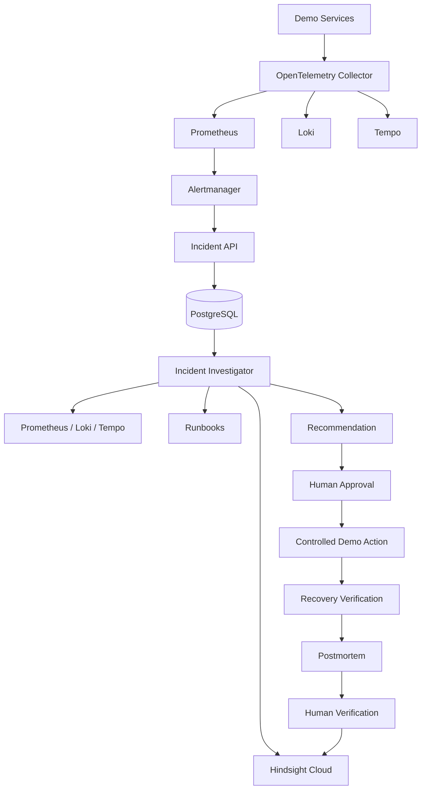

# Architecture

The platform uses deterministic application services around explicit system
boundaries:

- **PostgreSQL** is the authoritative system of record for incidents, lifecycle
  events, evidence, hypotheses, recommendations, approvals, runbooks,
  postmortems, and memory synchronization status.
- **Hindsight** is optional long-term verified organizational incident memory.
  It augments but never replaces PostgreSQL.
- **OpenTelemetry** is the instrumentation layer for trace and metric export.
- **Prometheus** scrapes metrics and evaluates alert rules.
- **Alertmanager** routes firing and resolved alerts to the incident API.
- **Demo microservices** provide a controlled production simulation with
  deterministic, resettable faults.
- A **Groq-backed investigator** may reason and select allowlisted read-only tools,
  but it does not own the lifecycle state machine or action gateway.
- A **human** remains the authority for disruptive demo actions and root-cause review.

HTTP route modules validate and serialize. Services own lifecycle rules.
Repositories own SQLAlchemy access. Invalid state transitions are rejected by a
deterministic policy rather than accepted from an agent or caller.

Historical incident memory is evidence to investigate, not authority to blindly
copy previous remediation.

## Current request flow

Alertmanager posts a typed webhook. `IncidentService` normalizes each alert,
deduplicates active alerts by fingerprint, persists or updates the incident, and
appends `ALERT_RECEIVED`. Resolved notifications mark the basic alert lifecycle
as resolved but never invent a root cause or postmortem.

## System flow

## Trust boundaries

Investigation, tool selection, approvals, remediation, recovery verification,
and postmortem generation are explicit, persisted workflow stages.

The LLM is an investigator, not an actuator. It selects only registered evidence tools
and returns a typed diagnosis and allowlisted recommendation. Human approval and action
execution are separate API calls. PostgreSQL remains authoritative; Hindsight receives
only incidents that passed resolution, root-cause, and postmortem verification.
